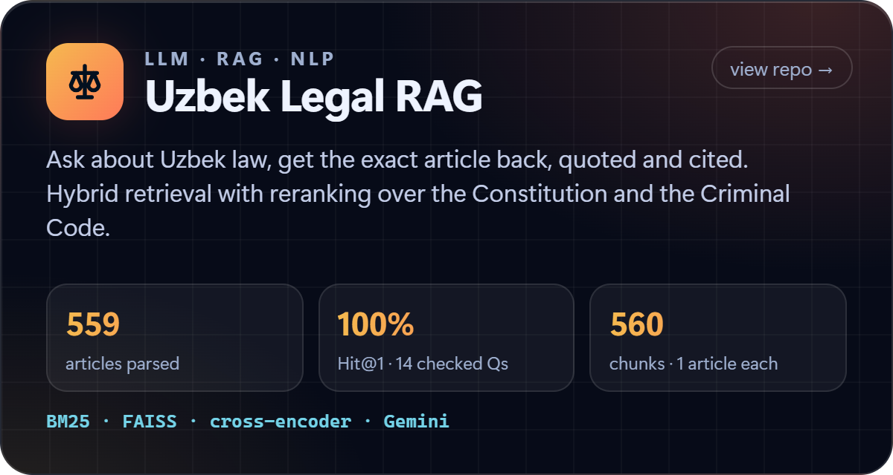
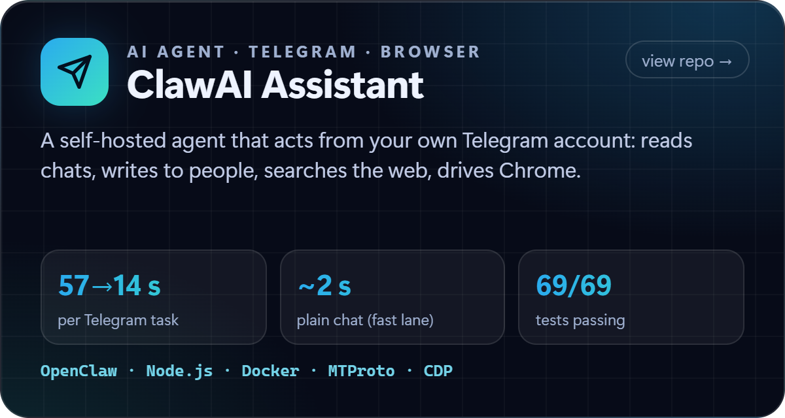
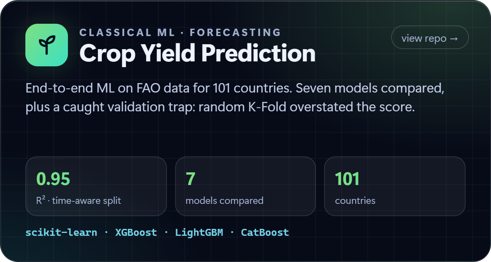
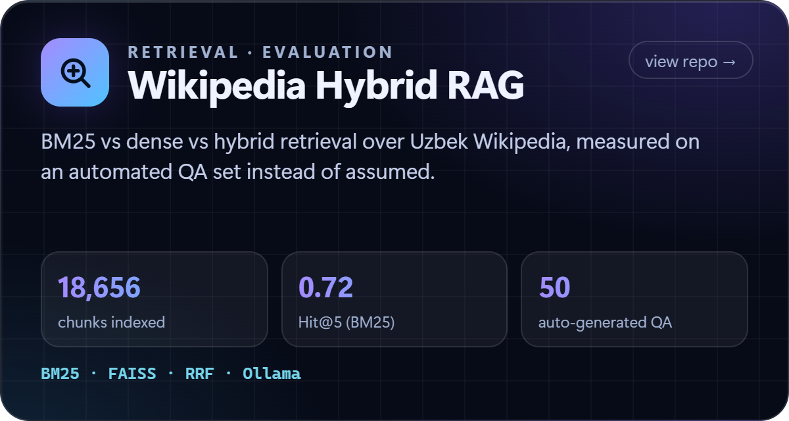

  

  
  
  

### Hi, I'm Ozod 👋

I build **AI systems that do real work and prove it with numbers**: retrieval-augmented
generation that cites its sources, agents that act inside real accounts, and classical ML
evaluated the honest way. When something is slow, I profile it before I touch it.

  

## ⭐ Featured work

<table>
  <tr>
    <td width="50%"></td>
    <td width="50%"></td>
  </tr>
  <tr>
    <td width="50%"></td>
    <td width="50%"></td>
  </tr>
</table>

<b>More projects</b>

 

| Project | What it is |
|---|---|
| [ai-data-analysis-platform](https://github.com/artikovozodbek/ai-data-analysis-platform) | FastAPI multi-agent platform: dataset understanding, cleaning suggestions, visualization, automated reports |
| [ai-teaching-assistant](https://github.com/artikovozodbek/ai-teaching-assistant) | Offline AI tutor: hybrid RAG (Chroma + BM25) over your own slides and books, Llama 3.2 via Ollama |
| [realtime-face-recognition](https://github.com/artikovozodbek/realtime-face-recognition) | Real-time webcam face recognition (InsightFace / ArcFace) with live enrollment, no retraining |
| [classical-machine-learning](https://github.com/artikovozodbek/classical-machine-learning) | KNN, SVM, trees, ensembles, XGBoost, applied to a churn-prediction case study |
| [python-learning-journey](https://github.com/artikovozodbek/python-learning-journey) | Python fundamentals to ML: basics → OOP → GUI → SQL → machine learning |

## 🧭 How I work

- **Measure first.** ClawAI felt "slow"; a CPU profile showed the model was fine (2.3 s) and
  the real cost was file-system calls over a Windows mount. Fixing that, plus a fast-lane
  plugin, took tasks from 57 s to 14 s and chat to ~2 s.
- **Evaluate honestly.** In crop-yield prediction, random K-Fold reported R² 0.987; a
  time-aware split gave 0.952, the number that reflects the real use. I report the lower one.
- **Cite, don't invent.** My RAG systems return the article or passage they used, and each
  README states the size and limits of its test set.
- **Ship it end to end.** Docker, tests, setup scripts, safety rules and a README a stranger
  can follow.

## 🛠️ Tech stack

  

| Area | Tools |
|---|---|
| **LLM, RAG and agents** | FAISS, BM25, cross-encoder reranking, Reciprocal Rank Fusion, ChromaDB, LangGraph, OpenClaw, Gemini / OpenAI-compatible APIs, Ollama |
| **Machine learning** | scikit-learn, XGBoost, LightGBM, CatBoost, pandas, NumPy, PyTorch (fundamentals) |
| **Computer vision** | OpenCV, InsightFace (ArcFace) |
| **Backend and infrastructure** | FastAPI, Node.js, Docker Compose, PostgreSQL, Redis, Telegram Bot API / MTProto |

## 📍 Right now

- Studying in the **AI/ML program at Najot Ta'lim** and working as a **support teacher**
  for Python, SQL and C.
- Growing **ClawAI** into a bigger product: Uzbek voice, scheduled tasks, safe payments.
- Looking for an **AI/ML engineering internship** where models go to production.

  

